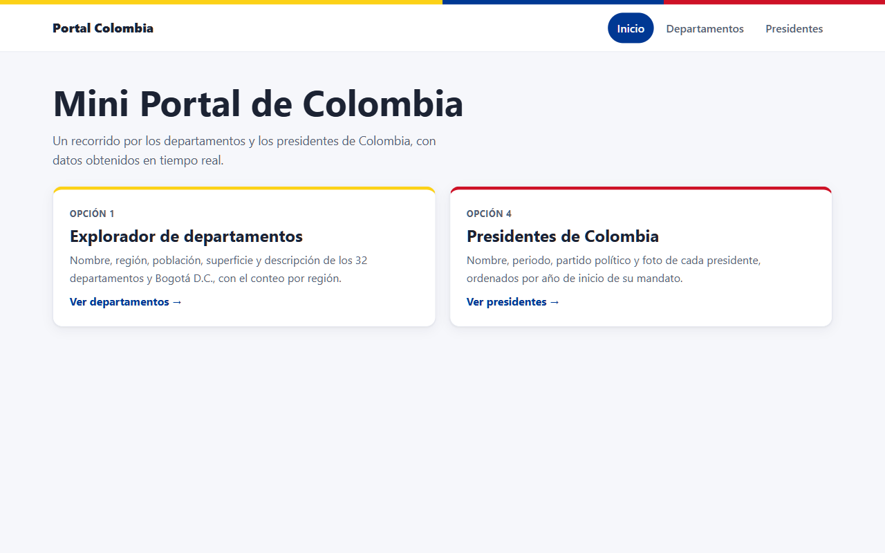
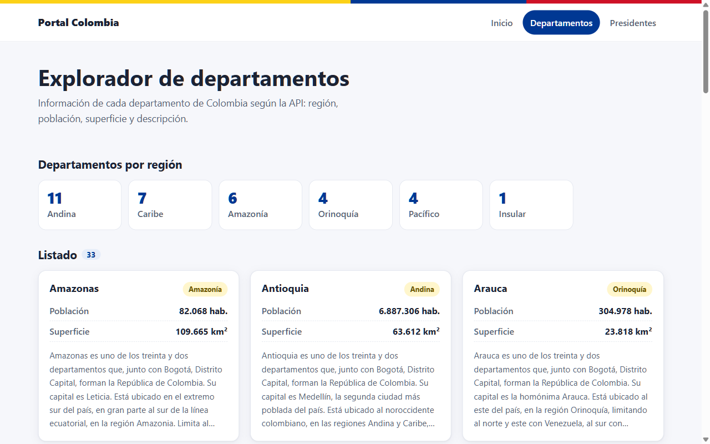
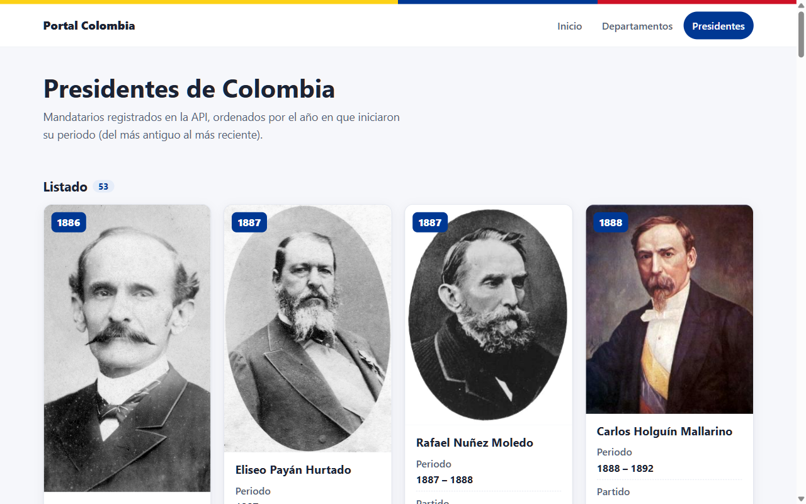
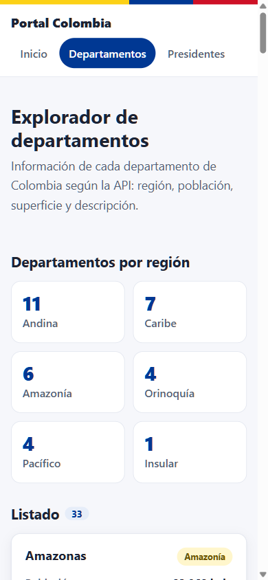

# Mini Portal de Colombia con API

## Descripción

Sitio web informativo sobre Colombia que consume la API pública [API Colombia](https://api-colombia.com/) con `fetch` y construye el contenido de forma dinámica en el DOM con JavaScript.

Se desarrollaron 2 de los 5 planteamientos propuestos, cada uno en su propia página y conectados entre sí con hipervínculos:

| Página | Planteamiento | Endpoint(s) | Qué muestra | Extra |
|---|---|---|---|---|
| `departamentos.html` | 1. Explorador de departamentos | `/api/v1/Department` y `/api/v1/Region` | Nombre, región, población, superficie y descripción de los 33 departamentos | Conteo de departamentos por región |
| `presidentes.html` | 4. Presidentes de Colombia | `/api/v1/President` | Nombre, periodo, partido político y foto | Ordenados por año de inicio del periodo |

Además, `index.html` es la página de inicio con enlaces a ambas secciones.

### Detalles de la implementación

- **Carga y errores:** cada página muestra un mensaje de carga mientras llega la respuesta; si `fetch` falla o la API responde con un estado de error, el `catch` muestra un mensaje de error en pantalla.
- **DOM:** todo el contenido se crea con `document.createElement` y `textContent` (no se usa `innerHTML` con datos de la API).
- **Regiones:** la API de departamentos solo trae `regionId`, por eso se consulta también `/Region` (en paralelo con `Promise.all`) para mostrar el nombre de la región.
- **Imágenes:** varias fotos de presidentes que trae la API no funcionan:
  - Miniaturas de Wikimedia con anchos no estándar (por ejemplo `99px`) que hoy responden con error 400. El código las reescribe a un ancho estándar (`330px`), que sí carga.
  - Archivos que ya no existen en Wikimedia (error 404). Para esos se buscaron imágenes válidas en Wikimedia Commons y se reemplazan por id en `IMAGENES_REEMPLAZO` (`js/presidentes.js`).
  - Si una imagen sigue fallando (o la API no trae imagen y no se encontró una libre), se reintenta una vez y luego se muestra `img/sin-foto.svg`. Esto pasa con la Junta Militar de 1957, José Antonio Montalvo, Rafael Azuero Manchola e Indalecio Liévano Aguirre.

## Wiki

La documentación detallada del proyecto está en la wiki: https://github.com/andrewk-g/api-colombia/wiki

## Tecnologías usadas

- HTML5 semántico
- CSS3 (Grid, Flexbox, variables CSS, diseño responsive)
- JavaScript (ES2020+, `fetch`, `async/await`, `Promise.all`)
- [API Colombia](https://api-colombia.com/) como fuente de datos

## Estructura del proyecto

```
├── index.html
├── departamentos.html
├── presidentes.html
├── css/
│   └── styles.css
├── js/
│   ├── api.js            # fetch, mensajes de carga/error y utilidades compartidas
│   ├── departamentos.js
│   └── presidentes.js
├── img/
│   └── sin-foto.svg      # imagen de respaldo
├── capturas/             # capturas de pantalla del README
└── README.md
```

## Instrucciones de uso

1. Clona el repositorio:
   ```bash
   git clone https://github.com/andrewk-g/api-colombia.git
   ```
2. Abre `index.html` en el navegador (doble clic), o sírvelo con un servidor local, por ejemplo la extensión **Live Server** de VS Code o:
   ```bash
   npx serve .
   ```
3. Navega entre **Departamentos** y **Presidentes** desde el menú superior.

Se necesita conexión a internet, porque los datos se piden a la API en cada carga.

## Capturas

### Inicio



### Explorador de departamentos



### Presidentes de Colombia



### Vista en móvil



## Estudiante

**Nombre:** _Camilo Andres Gonzalez Cespedes_
